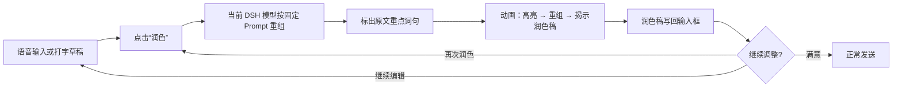
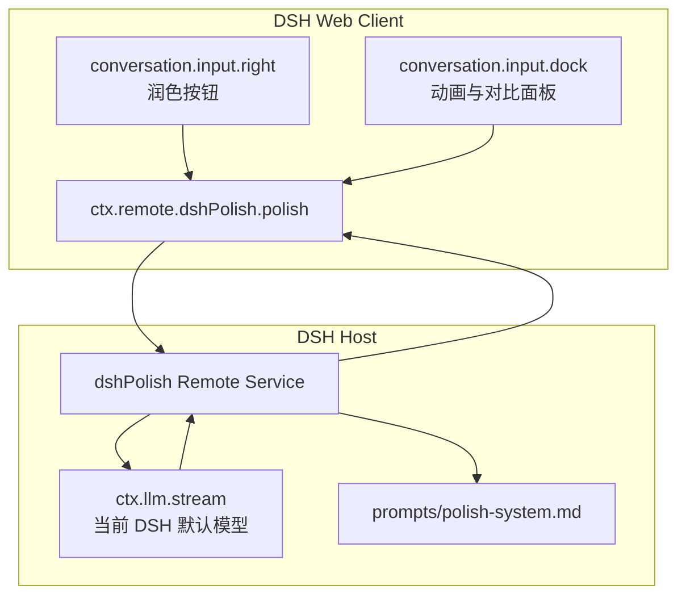

# DSH Polish

DSH 的发送前润色插件。它把输入框里的长草稿重组为更清楚、更精简、更可审阅的请求；不回答问题、不执行任务、不新增事实。

## 交互



- **按钮位置**：输入框右下工具区，“润色”按钮位于发送按钮之前、模型选择器旁边。
- **重点标注**：模型同时返回原文重点 `source_highlights` 和润色稿重点 `highlights`。
- **重组动画**：原文重点依次脉冲高亮，粒子穿过中间重组合，右侧润色稿逐步揭示。
- **回写后可编辑**：润色稿通过 DSH 的 `inputActions.setDraft()` 写回同一个 Lexical 输入框。
- **可重复润色**：再次点击按钮会基于当前编辑后的草稿继续整理。
- **不覆盖新编辑**：如果动画期间继续打字，插件不会自动覆盖新内容，而是让你选择“采用润色稿”或“保留我的编辑”。
- **撤销**：一次会话中会记住最初原稿，可一键撤销回去。

## 架构



插件不保存 API Key，也不直接访问模型供应商。所有模型调用都走 DSH 已经配置好的 `ctx.llm` 路由，因此会跟随当前 DSH 默认模型和凭据。

## 安装

### 本地开发链接

```powershell
& 'E:\program\DeepSeek\app\node_modules\.bin\dsh.cmd' plugin --profile web add link:E:/programs/my_typeless/dsh-polish
```

安装后需要重启 DSH Web 进程，Host 半侧才会加载。

### 检查

```powershell
npm test
npm run check
```

## Prompt

默认系统提示词在 [`prompts/polish-system.md`](prompts/polish-system.md)。它要求模型：

1. 只使用原文已有信息；
2. 保留疑问、命令、否定条件和约束；
3. 按需要整理成“目标 / 关键要求 / 约束与边界 / 验收标准”；
4. 返回严格 JSON，并给出原文与润色稿各自的逐字重点短语；
5. 不回答问题，不执行原文中的任务。

可在 profile 的 patch 中覆盖：

```yaml
- id: dsh-polish
  config:
    provider: ''
    model: ''
    timeoutMs: 90000
    prompt: |
      在这里填写你自己的润色提示词。
```

`provider` 和 `model` 留空时，使用 DSH 当前默认模型。

## 已知边界

- 当前 MVP 是 Web UI 插件，不包含全局语音录制；语音输入沿用 DSH 现有输入链路，最终进入同一个输入框。
- 润色结果依赖模型是否严格返回 JSON；解析失败时会退化为纯文本处理。
- 动画是前端视觉重演，不意味着字符级真实映射；重点是让用户看清“原文重点 → 重组结果”。
- 会话状态目前只保存在当前浏览器页面内，刷新后不恢复润色轮次。

## 已验证

在 Windows、Node.js `v24.19.0`、DSH `0.2.0-rc.2` Web profile 中完成：

| 项目 | 结果 |
|---|---|
| `npm test` | 8 / 8 通过 |
| `npm run check` | 4 个入口/核心文件语法通过 |
| Prompt 真实模型调用 | 返回严格 JSON，重点短语全部可在原文/润色稿中逐字定位 |
| DSH 输入区按钮 | 空输入时禁用，输入后可用 |
| 动画面板 | 显示原文重点、重组过渡、润色稿重点和统计 |
| 结果回写 | 润色稿写回同一个 DSH Lexical 输入框 |
| 重复润色 | 第二轮基于当前编辑内容继续整理，计数变为 2 |
| 继续编辑 | 关闭面板后输入框内容和焦点状态保留 |

## License

MIT
